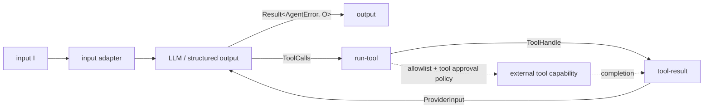

# Graphs as Library Data

[`nefor/graph.mag`](../../lib/nefor/graph.mag) defines `Port`, `Node`, `Edge`,
and `Graph` as nominal MAG types. The user-facing center is `Node<I, O>`; ports
and stored routes are its representation and remain available for advanced live
modifications.

## Actors

An actor is one runtime capability with a stable identity, a factory identity,
typed input and output ports, type arguments, and packed parameters. A factory
may implement an LLM request, process execution, tool coordination, a human
approval, or an adapter. The graph treats each actor as a black box whose
observable contract is its ports and messages.

Actor-specific MAG libraries define the parameter records and construct the
actors. The runtime instantiates each actor through its factory; it does not
receive one monolithic workflow configuration and infer hidden steps.

## Node boundary

A `Node<I, O>` composes capability actors, their internal routes, declarative
operations, and explicit messages behind one typed input and output boundary.
Fixed combinators do not add graph entities: they append ordered boundary
transforms (`Unit`, `Project`, `Pack`, `Unpack`, `Assemble`, `EmptyList`) to
boundary leaves and flows. Lowering carries those transforms on routes and
messages. The completed graph owns initial activation: each exposed, unfed node
boundary whose complete input type is exactly `Unit` gets one bootstrap message.
A nominal ADT or product merely containing `Unit` does not. An incoming route or
explicit input message keeps the node dependency-driven, and internal actors are
never independently bootstrapped through a composite boundary. The functions in
[`nefor/node.mag`](../../lib/nefor/node.mag) compose these values directly:
`>>>`, `*>`, `fanout`, `parallel`, `choose`, and `sequence`. An `Edge` connects
the final node to the surrounding topology. Compatibility is checked before the
artifact exists.

Operations are immutable program data, not graph edges or executable MAG
functions. Version 4 has one operation, `InstantiateDeltaTemplate`, for
runtime-sized structural expansion.

Graph composition is an identity union, not tree expansion. Reusing one bound
node contributes its capability actors, routes, operations, logical-node
metadata, and exact messages idempotently, in first-occurrence order. The
reused actor remains one runtime actor: Nefor neither clones its execution nor
adds a memoization layer. Distinct transformed routes from that actor are all
retained, so one result can still feed several downstream destinations. Exact
repeated messages collapse as definitions; messages with different content or
transform sequences remain distinct.

An identity is also an immutable contract. Actors compare their complete
factory, type, parameter, port, and templateability definition. Stored nodes
compare role, typed boundaries, and the complete sets of actor, route, message,
and operation definitions; set order is irrelevant, but adding, removing, or
changing any execution definition changes the node. Logical hierarchy metadata
is checked separately. Routes compare both typed ports and their ordered
transforms, operations compare the complete operation, and logical nodes
compare complete membership at a path. A repeated compatible definition
disappears from the emitted program. A divergent definition never wins by order:
compilation reports both definitions and the child occurrence that introduced
each one, including its actual logical paths and nested composition side or
sequence index.

## Sources, output, and edges

A complete graph needs at least one root, one output, and edges between them:

```mag
import core.types.{}
import agents.{}
import nefor.actors.{}
import nefor.artifact.{}
import nefor.contracts.{}
import nefor.graph.{}

type InspectionInput {prompt: String}

let start = nefor.graph.source("task", InspectionInput {prompt: "Inspect the repository."})
let worker = agents.agent<InspectionInput, nefor.contracts.TextAnswer>("worker", agents.AgentConfig {
  model: agents.standard,
  system: "Inspect the repository and report the result.",
  tools: nefor.actors.read_only_tools,
  tool_approval_policy: nefor.contracts.ToolApprovalPolicy.Default()
})
let result = nefor.graph.output<core.types.Result<nefor.contracts.AgentError, nefor.contracts.TextAnswer>>("result")

nefor.artifact.compile((|graph| => nefor.graph.add_edges(graph, [
  nefor.graph.edge(start, worker),
  nefor.graph.edge(worker, result),
])): fn(nefor.graph.Graph) -> nefor.graph.Graph)
```

`nefor.graph.source<T>(id, value)` is a `Node<Unit, T>` that emits a value
checked against `T`. It is one root among many: any exposed node whose complete
input type is exactly `Unit` can be an unfed root and receives one automatic
activation, as described under the node boundary above.

`nefor.graph.output<T>(id)` is a concrete `T -> T` pass-through node and the
result boundary; `output_for(id, node)` derives `T` from a preceding node, and
`compile_graph` adds such an output for you. A graph contains exactly one
output, the output is terminal, and every node must be reachable from a root
and able to reach the output.

`nefor.graph.edge(from, to)` connects compatible nodes. A producer may fan out
through several edges, and a consumer may fan in through several edges. The
consumer's input type decides when it fires:

- A single input fires for each matching arrival.
- A nominal ADT input fires for each complete owner value. Constructors are
  unpacked only by explicit branching nodes such as `choose` or the Result
  combinators, never by an edge.
- A product input `(A, B)` fires only after every occurrence is filled. This is
  the all-of join, and each occurrence needs its own incoming edge: `(T, T)`
  needs two.
- A `Unit` edge expresses ordering without transferring domain data.
- Cycles are legal while every node stays reachable from a root and able to
  reach the output.

There is no graph mutation API. `graph(edges)`, `add_edges`, and
`remove_edges` are total pure operations over the edge set being authored.
Build one flat edge list; compose edge families with `concat` and `map` rather
than nested lists. Compilation rejects a graph that breaks these rules; see
[graph validation errors](<05. Lowering and Execution.md#graph-validation-errors>).

## An agent node

[`nefor.actors.agent`](../../lib/nefor/actors.mag) is the reusable generic
constructor. It accepts a configuration-owned typed model resolver and a
complete `AgentConfig`, including `ToolApprovalPolicy`, and returns
`Node<I, core.types.Result<AgentError, O>>`. A distribution may close over its
own model vocabulary and resolver with concise constructors, as the starter's
`agents` module does. Both boundaries hide the provider/tool loop while
preserving every terminal result type.



The stored node has exactly four actors: the input adapter, the LLM (or
structured-output factory), `run-tool`, and `tool-result`. `run-tool` receives
the tool allowlist and normalized approval metadata as parameters. An authored
`Rules(ToolApprovalRules)` value retains its exact rule map through that
normalization, but the tool gate does not enforce those per-agent rules; its
configured policy and validator own authorization. The dashed path is
capability work outside the stored actor graph; the policy and tool execution
are not two extra actors hidden inside the node.

The input type selects how a turn starts. The nominal `ProviderInput` type
passes an already-built provider turn through unchanged; every other input type
starts a fresh typed user turn. Authors choose only types: the runtime wire tags
stay inside the constructors and are not part of the MAG authoring API.

`tools` is the agent's capability boundary. Use `nefor.actors.read_only_tools`,
`nefor.actors.general_tools`, or an explicit list of tool names. The tool gate
rejects a call to a tool outside that allowlist even when the tool exists
globally.

The whole `Result<AgentError, O>` must reach a compatible downstream node or the
output. A direct edge from the agent to an `O` input is incompatible, because it
would erase the `Result` constructor. Accept the full `Result` when a downstream
node can work with failures; otherwise continue only `Ok` with `and_then`,
`result_map`, or <code>nefor.result.`>=>`</code>, and transform only `Error` with
`map_error`.

`AgentError` carries `last_output`, the latest raw provider output, and a
`reason`. The only reason today is `ProviderError {message, detail}`, a genuine
provider failure. Invalid structured output is not an error result: the
structured-output boundary keeps asking the model to correct its draft within
the same activation, as the runtime's
[structured output boundary](../../../plugins/mag/docs/actor-model.md#structured-output-boundary)
describes. Do not parse provider prose as a substitute for `O`.

The
[`typed-task.mag`](../../../examples/nefor-agent/agentic-loop/typed-task.mag)
example composes the agent node between a source and output.
